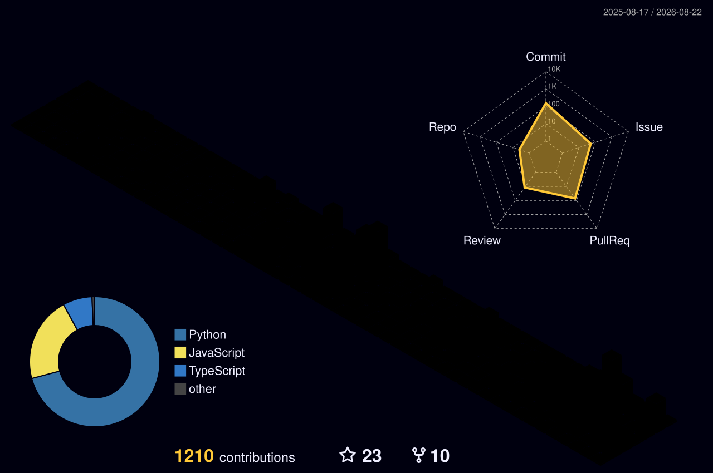

<h1 align="center">Konichiwa 👋</h1>

  

  

## About Me 💬

Computer enthusiast from India, building for the web and going deeper into systems.

**Currently learning**

- ✨ Data Structures & Algorithms
- ✨ DevOps

**Hobbies**

- ✨ Chess addict
- ✨ Watching anime
- ✨ Gym

 

## Technologies 🛠️

<table>
  <tr>
    <td><strong>Web Development</strong></td>
    <td></td>
  </tr>
  <tr>
    <td><strong>Languages</strong></td>
    <td></td>
  </tr>
  <tr>
    <td><strong>Cloud &amp; Deployment</strong></td>
    <td></td>
  </tr>
  <tr>
    <td><strong>Tools</strong></td>
    <td></td>
  </tr>
</table>

## GitHub Stats 📊

  

  
  
  
  
  

  

## LeetCode Stats 🧩

  

## Contact Me 📫

  
  
  

